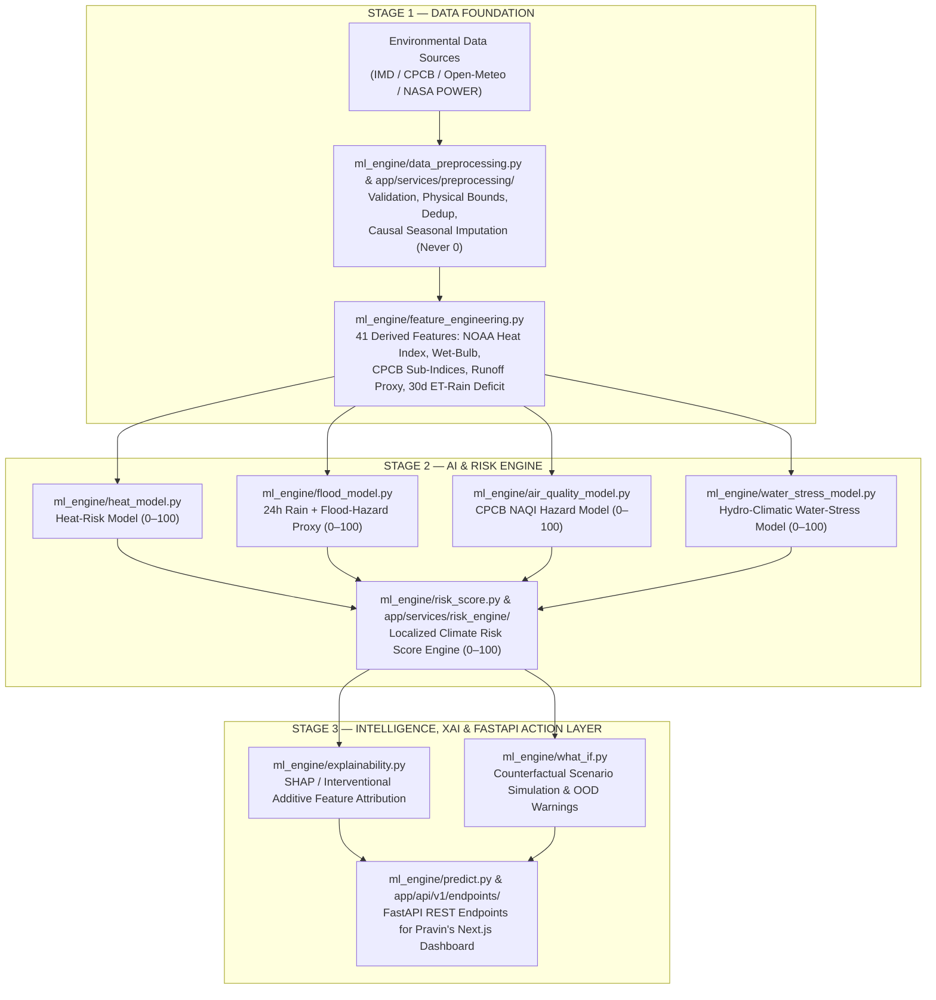

# ClimateTwin AI — Unified Backend & AI/ML Intelligence Platform
> **Predict. Assess. Protect.**  
> Official Integrated Repository for **ClimateTwin AI** (Team PrithviNex | AISSMS College of Engineering for PCCOE International Grand Challenge 2026).

---

## 👥 Team Workstreams & Responsibilities

| Lead | Role | Primary Responsibility |
| :--- | :--- | :--- |
| **Lokesh Joshi** | **AI / ML Lead** | Complete AI/ML Intelligence Engine (`ml_engine/`), 4 Hazard ML Models (Heat, Flood, Air Quality, Water Stress), Explainable AI (SHAP / Interventional Attribution), What-If Counterfactual Engine, Model Evaluation & Diagnostics (`evaluation/`, `notebooks/`) |
| **Mayuresh Kamble** | **Backend & Data Lead** | Environmental API ingestion (`app/services/ingestion/`), PostgreSQL/SQLite database (`app/db/`), FastAPI REST endpoints (`app/api/v1/`), ML Bridge (`app/services/ml_bridge/`) |
| **Pravin Kamble** | **Frontend & Visualization Lead** | Next.js dashboard, interactive Leaflet climate-risk map, Recharts trends, simulation UI |

---

## 🏛️ Unified System Architecture



---

## 📂 Integrated Project Structure

```text
ClimateTwin-AI/
├── app/                           # FastAPI Backend Layer (Mayuresh Kamble)
│   ├── main.py                    # FastAPI application entrypoint & CORS middleware
│   ├── api/v1/endpoints/          # /locations, /weather, /air-quality, /predict, /predict/intelligence, /risk-score, /simulate, /recommendations, /history
│   ├── core/                      # Config, logging, domain exceptions
│   ├── db/                        # SQLAlchemy models & session management
│   ├── schemas/                   # Pydantic request/response contracts
│   └── services/                  # Ingestion, preprocessing, ml_bridge, risk_engine, recommendation
├── ml_engine/                     # AI/ML Intelligence Engine (Lokesh Joshi)
│   ├── __init__.py
│   ├── config.py                  # Canonical schemas, CPCB breakpoints, Pune climatology, weights
│   ├── reference_data.py          # Pune pilot dataset generator & transparent hazard proxy equations
│   ├── data_preprocessing.py      # Module 1: Leak-free validation, outlier/extreme flagging & imputation
│   ├── feature_engineering.py     # Module 2: 41 causal meteorological/hydrological/CPCB features
│   ├── heat_model.py              # Module 3: Heat-Risk prediction (Ridge vs RF vs GradientBoosting/XGB)
│   ├── flood_model.py             # Module 4: 24h Rainfall + Hydrometeorological Flood-Hazard Proxy
│   ├── air_quality_model.py       # Module 5: CPCB NAQI Air-Quality Risk + dominant pollutant ranking
│   ├── water_stress_model.py      # Module 6: Hydro-Climatic Water-Stress Analysis
│   ├── risk_score.py              # Module 7: Weighted Climate Risk Score Engine (0–100)
│   ├── model_evaluation.py        # Module 8: Chronological Train/Val/Test metrics & diagnostic plots
│   ├── explainability.py          # Module 9: SHAP / Interventional additive local & global XAI
│   ├── what_if.py                 # Module 10: Counterfactual climate simulation engine
│   ├── predict.py                 # Module 11: Unified JSON inference interface for FastAPI
│   ├── demo_workflow.py           # End-to-end seasonal & multi-city demonstration workflow
│   └── train_baseline_models.py   # Fast adapter baseline trainer
├── datasets/
│   ├── pune_environmental_historical.csv
│   ├── raw/pune_environmental_timeseries.csv
│   ├── processed/                 # preprocessor.joblib & pune_processed_features.csv
│   └── README.md                  # 9-point dataset documentation & feasibility matrix
├── models/
│   ├── *.joblib                   # Fast adapter models for app/services/ml_bridge
│   ├── heat/                      # Full 18-feature HeatRiskModel artifact + metadata
│   ├── flood/                     # Full 18-feature FloodRiskModel artifact + metadata
│   ├── air_quality/               # Full 17-feature AirQualityRiskModel artifact + metadata
│   └── water_stress/              # Full 19-feature WaterStressModel artifact + metadata
├── notebooks/                     # 5 Jupyter Notebooks for EDA & hazard model training
├── evaluation/
│   ├── metrics/                   # evaluation_report.json, model_comparison.csv, final_demo_outputs.json
│   └── plots/                     # 4 publication-grade diagnostic & confusion matrix visualizations
├── tests/                         # 47 Automated Unit & FastAPI Integration Tests
├── scripts/                       # Dataset builder & database seeding utilities
├── docs/FRONTEND_INTEGRATION_GUIDE.md
├── test_live_system.py            # End-to-end live FastAPI subsystem verification script
├── requirements.txt
└── README.md
```

---

## 📊 Actual Model Evaluation Results (Held-Out Chronological Test Split)

All models in `ml_engine/` were trained on the first **70%** (`1,235` days) of the Pune pilot time-series, selected on the next **15%** (`265` days) validation split, and evaluated on the final held-out **15%** (`265` days) chronological test split:

| Hazard Model | Selected Algorithm | Validation RMSE | Test MAE | Test RMSE | Test R² | 5-Tier Category Accuracy | Weighted F1 | Elevated-Risk ROC-AUC |
| :--- | :--- | :---: | :---: | :---: | :---: | :---: | :---: | :---: |
| **Heat Risk (`heat_model.py`)** | `gradient_boosting_xgb_equivalent` | `1.7493` | `1.1510` | `1.4816` | `0.9958` | `96.98%` | `96.98%` | `0.9982` |
| **Flood Proxy (`flood_model.py`)** | `gradient_boosting_xgb_equivalent` | `1.1990` | `0.4585` | `0.8670` | `0.9979` | `99.25%` | `99.25%` | `1.0000` |
| **Air Quality (`air_quality_model.py`)** | `gradient_boosting_xgb_equivalent` | `0.2267` | `0.1564` | `0.2335` | `0.9996` | `99.62%` | `99.62%` | `1.0000` |
| **Water Stress (`water_stress_model.py`)** | `gradient_boosting_xgb_equivalent` | `2.3502` | `0.4533` | `1.8550` | `0.9981` | `99.25%` | `99.29%` | `0.9999` |

---

## 📡 FastAPI Endpoints Summary

| Method | Endpoint | Description |
| :--- | :--- | :--- |
| `GET` | `/api/v1/locations` | Supported locations and Pune micro-wards (Shivajinagar, Kothrud, Hadapsar, Lohegaon, Hinjawadi, Katraj) |
| `GET` | `/api/v1/weather` | Real-time weather and 24h forecast with explicit provenance tracking |
| `GET` | `/api/v1/air-quality` | Real-time air quality metrics (AQI, PM2.5, PM10, NO2, SO2, CO, O3) |
| `POST` | `/api/v1/predict` | Executes hazard-specific ML adapter inferences (`PredictionResponse`) |
| `POST` | `/api/v1/predict/intelligence` | Executes Lokesh's full `ml_engine.predict.generate_complete_prediction` (Hazards + Risk Score + XAI + What-If + Recommendations) |
| `GET` | `/api/v1/risk-score` | Flagship Climate Risk Score (0-100) and risk level contract |
| `GET` | `/api/v1/risk-score/map` | Batch risk scores, coordinates & color codes for all 6 Pune wards |
| `GET` | `/api/v1/history` | Historical reanalysis (ERA5) multi-day time-series for frontend charts |
| `GET` | `/api/v1/recommendations` | Targeted adaptation actions for Municipal, Citizens, Disaster Management, Agriculture |
| `POST` | `/api/v1/simulate` | What-If climate simulation engine (e.g., +30% rain, +2.0°C warming) |

---

## 🛠️ Execution & Verification Commands

```powershell
# 1. Train & evaluate all 4 ML Intelligence Engine hazard models and generate plots/metrics
python -m ml_engine.model_evaluation

# 2. Run the complete automated test suite (Backend + ML Engine tests)
python -m pytest tests/ -v

# 3. Run the ML Demonstration Workflow across seasonal case studies & multi-city scenarios
python -m ml_engine.demo_workflow

# 4. Start the FastAPI server
python -m uvicorn app.main:app --host 0.0.0.0 --port 8000 --reload
```

---

## 💻 Frontend Application (Next.js 16 + React 19)

**Lead:** Pravin Kamble — Frontend & Visualization Lead

The repository includes a modern, responsive climate-intelligence frontend built with Next.js 16 (App Router), React 19, TypeScript, Tailwind CSS, React Leaflet, and Recharts.

### Frontend Structure
```
frontend/
├── src/
│   ├── app/
│   │   ├── page.tsx               # Landing Page & Architecture Overview
│   │   ├── dashboard/page.tsx     # Main Multi-Hazard Risk Dashboard
│   │   ├── map/page.tsx           # Interactive React Leaflet GIS Map
│   │   ├── simulation/page.tsx    # What-If Climate Scenario Simulation
│   │   ├── recommendations/page.tsx # Stakeholder Action Playbooks
│   │   └── about/page.tsx         # Team PrithviNex & Challenge Vision
│   ├── components/                # Modular Dashboard, Maps, Charts & UI components
│   ├── services/api.ts            # Axios API Service Layer (/api/v1/...)
│   └── context/                   # Global Location & Theme Context
```

### Running the Frontend
```bash
cd frontend
npm install --legacy-peer-deps
npm run dev
```
Open [http://localhost:3000](http://localhost:3000) to view the application.
