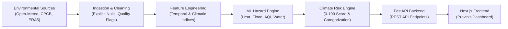

# ClimateTwin AI — Backend & Data Intelligence Platform

> **Predict. Assess. Protect.**  
> Official Backend Engine for **ClimateTwin AI** (Team PrithviNex | AISSMS College of Engineering for PCCOE International Grand Challenge 2026).

---

## 👥 Team Workstreams & Responsibilities

| Lead | Role | Primary Responsibility |
| :--- | :--- | :--- |
| **Mayuresh Kamble** | **Backend & Data Lead** | Environmental API ingestion, data cleaning, PostgreSQL/Supabase database, FastAPI endpoints, integration contracts |
| **Lokesh Joshi** | **AI / ML Lead** | Hazard ML models (Heat, Flood, Air Quality, Water Stress), feature importance (SHAP), model weights |
| **Pravin Kamble** | **Frontend & Visualization Lead** | Next.js dashboard, interactive Leaflet climate-risk map, Recharts trends, simulation UI |

---

## 🏛️ System Architecture



---

## 🚀 Key Architectural Principles
1. **Zero Data Fabrication**: Missing environmental measurements are never masked to `0.0`. Measured zero (e.g., `0.0 mm` rain) is strictly differentiated from missing sensor data (`null` with `quality_flag="DEGRADED"`).
2. **Provenance & Auditability**: Every observation carries an immutable source name, observation timestamp, and ingestion timestamp.
3. **Decoupled ML Interface**: The backend features an abstract inference adapter. When Lokesh deposits trained `.joblib` model weights into `models/`, the engine runs ML inference; otherwise, it operates using scientifically calibrated Pune baseline heuristic models with `inference_mode="calibrated_heuristic"`.
4. **CORS Ready**: Pre-configured for Pravin's Next.js development server at `http://localhost:3000`.

---

## 📡 API Endpoints Summary

| Method | Endpoint | Description |
| :--- | :--- | :--- |
| `GET` | `/api/v1/locations` | Supported locations and Pune micro-wards (Shivajinagar, Kothrud, Hadapsar, Lohegaon, Hinjawadi, Katraj) |
| `GET` | `/api/v1/weather` | Real-time weather and 24h forecast with explicit provenance tracking |
| `GET` | `/api/v1/air-quality` | Real-time air quality metrics (AQI, PM2.5, PM10, NO2, SO2, CO, O3) |
| `POST` | `/api/v1/predict` | Executes hazard-specific ML inferences (Heat, Flood, Air Quality, Water Stress) |
| `GET` | `/api/v1/risk-score` | Flagship Climate Risk Score (0-100) and risk level contract |
| `GET` | `/api/v1/risk-score/map` | **Interactive Map API**: Batch risk scores, coordinates & color codes for all 6 Pune wards |
| `GET` | `/api/v1/history` | Historical reanalysis (ERA5) multi-day time-series for frontend charts |
| `GET` | `/api/v1/recommendations` | Targeted adaptation actions for Municipal, Citizens, Disaster Management, Agriculture |
| `POST` | `/api/v1/simulate` | What-If climate simulation engine (e.g., +30% rain, +2.0°C warming) |

---

## 🛠️ Quickstart & Local Execution

### 1. Environment Setup
```powershell
# Verify Python 3.11+ is active
python --version

# Install dependencies
python -m pip install -r requirements.txt
```

### 2. Configure Environment
Copy `.env.example` to `.env` (pre-configured with sensible defaults for Pune, MH):
```powershell
cp .env.example .env
```

### 3. Run Development Server
```powershell
python -m uvicorn app.main:app --host 0.0.0.0 --port 8000 --reload
```
Interactive Swagger API documentation:
- Swagger UI: `http://localhost:8000/docs`
- ReDoc: `http://localhost:8000/redoc`

### 4. Run Automated Test Suite
```powershell
python -m pytest tests/ -v
```

